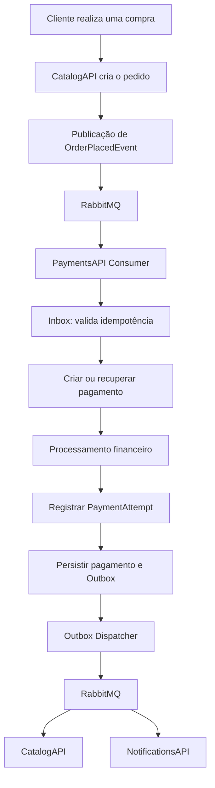

# 💳 FCG.PaymentsAPI

Microsserviço responsável pelo domínio financeiro da plataforma **FIAP Cloud Games (FCG)**.

O `FCG.PaymentsAPI` é responsável pelo recebimento, processamento e gerenciamento dos pagamentos associados aos pedidos realizados na plataforma.

Desenvolvido em **.NET 8**, utiliza arquitetura orientada a eventos para consumir pedidos através do RabbitMQ, processar transações financeiras, persistir seus resultados e comunicar os demais microsserviços por meio de eventos.

O serviço prioriza independência entre domínios, consistência dos dados, idempotência e tolerância a falhas.

---

## 📌 Responsabilidades

As principais responsabilidades do PaymentsAPI são:

- **Recebimento de pedidos:** consumo de `OrderPlacedEvent` publicado pelo Catalog através do RabbitMQ.
- **Criação de pagamentos:** criação de registros financeiros associados aos pedidos recebidos.
- **Processamento financeiro:** determinação do resultado da transação.
- **Controle de tentativas:** registro do histórico de processamento dos pagamentos.
- **Idempotência:** prevenção de pagamentos duplicados para um mesmo pedido.
- **Auditoria:** controle dos eventos recebidos e publicados através dos padrões Inbox e Outbox.
- **Comunicação entre microsserviços:** publicação de `PaymentProcessedEvent` com o resultado financeiro.

O PaymentsAPI não é responsável pelo gerenciamento de usuários, catálogo de jogos, pedidos, biblioteca ou notificações.

Cada domínio permanece sob responsabilidade de seu respectivo microsserviço.

---

## 🏗️ Arquitetura

O projeto utiliza **Clean Architecture**, com separação de responsabilidades em quatro camadas.

```text
FCG.PaymentsAPI/
│
├── src/
│   ├── FCG.Payments.Api/
│   │
│   ├── FCG.Payments.Application/
│   │
│   ├── FCG.Payments.Domain/
│   │
│   └── FCG.Payments.Infrastructure/
│
├── tests/
│   ├── FCG.Payments.UnitTests/
│   │
│   └── FCG.Payments.IntegrationTests/
│
├── FCG.Payments.sln
├── Dockerfile
└── README.md
```

### Responsabilidade das camadas

| Camada | Responsabilidade |
|---|---|
| API | Host HTTP, configuração, injeção de dependências e endpoints operacionais. |
| Application | Casos de uso, orquestração do processamento e abstrações. |
| Domain | Entidades financeiras, regras de negócio e transições de estado. |
| Infrastructure | Entity Framework Core, PostgreSQL, repositórios, Inbox e Outbox. |

### Direção das dependências

```text
API
 ├── Application
 └── Infrastructure
       ├── Application
       └── Domain

Application
 └── Domain

Domain
 └── Sem dependências das demais camadas
```

Essa organização mantém as regras de negócio independentes dos detalhes de infraestrutura e comunicação externa.

---

## 🔄 Comunicação entre microsserviços

A comunicação do PaymentsAPI é realizada de maneira assíncrona utilizando RabbitMQ como message broker e MassTransit como abstração de mensageria.

### Eventos utilizados

| Evento | Origem | Destino | Finalidade |
|---|---|---|---|
| `OrderPlacedEvent` | CatalogAPI | PaymentsAPI | Solicitar o processamento financeiro de um pedido. |
| `PaymentProcessedEvent` | PaymentsAPI | CatalogAPI | Comunicar o resultado do pagamento. |
| `PaymentProcessedEvent` | PaymentsAPI | NotificationsAPI | Permitir o processamento de notificações relacionadas ao pagamento. |

### Fluxo de processamento



### Detalhamento

1. O CatalogAPI registra um novo pedido.
2. O evento `OrderPlacedEvent` é publicado no RabbitMQ.
3. O PaymentsAPI recebe o evento através do consumer MassTransit.
4. A Inbox verifica se o evento já foi processado.
5. O pagamento é criado ou recuperado, evitando duplicidade.
6. O processamento financeiro determina o resultado.
7. A tentativa e o resultado são persistidos no PostgreSQL.
8. O evento `PaymentProcessedEvent` é armazenado na Outbox.
9. O Outbox Dispatcher publica o evento no RabbitMQ.
10. CatalogAPI e NotificationsAPI recebem o resultado.

---

## 💰 Processamento financeiro

Atualmente, o projeto utiliza um mecanismo de simulação determinística de pagamentos.

A aprovação ou rejeição é definida através de um limite configurável.

**Configuração padrão:**

```json
{
  "PaymentSimulation": {
    "ApprovalLimit": 100.00
  }
}
```

### Regras de processamento

| Condição | Resultado |
|---|---|
| Valor menor ou igual ao limite | `Approved` |
| Valor superior ao limite | `Rejected` |

Exemplo considerando um limite de R$ 100,00:

| Pedido | Valor | Resultado |
|---|---:|---|
| Pedido A | R$ 49,90 | Approved |
| Pedido B | R$ 149,90 | Rejected |

A decisão financeira e o registro de `PaymentAttempt` são persistidos conjuntamente.

Pagamentos que já atingiram um estado terminal não são reprocessados e não geram novas tentativas.

> **Importante:** o mecanismo atual é uma simulação financeira. Não existe integração com operadoras de cartão, instituições bancárias ou gateways de pagamento reais.

---

## 🛡️ Confiabilidade e consistência

O projeto utiliza padrões arquiteturais para aumentar a confiabilidade do processamento distribuído.

### Inbox Pattern

Responsável pelo controle das mensagens recebidas.

- Identificação dos eventos através do `EventId`.
- Unicidade por consumidor e evento.
- Prevenção de processamento duplicado.
- Persistência da Inbox e do pagamento na mesma transação local.

Além disso, o `OrderId` possui restrição de unicidade, impedindo a criação de múltiplos pagamentos lógicos para um mesmo pedido.

### Outbox Pattern

Responsável por garantir a publicação confiável dos eventos de saída.

- Registro dos eventos na mesma transação do processamento financeiro.
- Persistência dos eventos até sua publicação.
- Publicação posterior através do Outbox Dispatcher.
- Redução do risco de inconsistência entre o estado financeiro e a comunicação com os demais microsserviços.

### Transações locais

O processamento utiliza transações no PostgreSQL para manter a consistência entre os registros financeiros e os mecanismos de controle de mensagens.

### Retentativas

O consumer utiliza políticas de retentativas para falhas transitórias.

- Até três retentativas escalonadas.
- Após o esgotamento das tentativas, a mensagem é encaminhada para a fila de erro `payments-order-placed_error`.

---

## 🗄️ Banco de dados

O serviço utiliza PostgreSQL como banco de dados exclusivo do domínio financeiro.

A persistência é realizada através de:

- Entity Framework Core.
- Migrations para versionamento do schema.
- Repositórios.
- Inbox e Outbox persistentes.

### Principais estruturas

| Estrutura | Finalidade |
|---|---|
| Payment | Armazenar os pagamentos associados aos pedidos. |
| PaymentAttempt | Registrar as tentativas de processamento financeiro. |
| Inbox | Controlar os eventos recebidos e processados. |
| Outbox | Armazenar os eventos pendentes de publicação. |

O PaymentsAPI não cria chaves estrangeiras para entidades pertencentes a outros microsserviços.

Os identificadores externos são armazenados como referências, preservando a independência entre os domínios.

---

## 🧰 Tecnologias utilizadas

| Tecnologia | Finalidade |
|---|---|
| C# | Linguagem de programação. |
| .NET 8 | Plataforma de desenvolvimento. |
| ASP.NET Core | Host da aplicação. |
| Entity Framework Core | ORM e persistência. |
| PostgreSQL | Banco de dados relacional. |
| RabbitMQ | Message broker. |
| MassTransit | Abstração e gerenciamento da mensageria. |
| xUnit | Testes automatizados. |
| Swagger / OpenAPI | Documentação da API. |
| Docker | Containerização da aplicação. |
| Kubernetes | Orquestração da aplicação através da infraestrutura central. |

---

# ⚙️ Execução e infraestrutura

O PaymentsAPI não possui responsabilidade de provisionar toda a infraestrutura da plataforma.

A execução integrada é centralizada em outro repositório:

**[FCG-FIAP-Repo-Infra](https://github.com/FCG-FIAP-Cloud-Games/FCG-FIAP-Repo-Infra)**

Esse repositório é responsável por disponibilizar:

- PostgreSQL e os bancos de dados dos microsserviços.
- RabbitMQ e sua infraestrutura de mensageria.
- UsersAPI.
- CatalogAPI.
- PaymentsAPI.
- NotificationsAPI.
- Configurações compartilhadas e recursos de execução.

Existem duas formas de executar a plataforma.

## 🐳 Docker Compose

A execução local integrada é realizada através do repositório de infraestrutura.

### 1. Clonar o repositório de infraestrutura

```bash
git clone https://github.com/FCG-FIAP-Cloud-Games/FCG-FIAP-Repo-Infra.git
```

### 2. Acessar a pasta do Docker Compose

```bash
cd FCG-FIAP-Repo-Infra/docker-compose
```

### 3. Configurar o ambiente

Configure o `.env` com as credenciais, parâmetros e tags das imagens utilizadas pela infraestrutura.

### 4. Inicializar a plataforma

```bash
docker compose up -d
```

Para verificar os containers:

```bash
docker compose ps -a
```

### 5. Acessar o PaymentsAPI

O Swagger estará disponível em:

```text
http://localhost:5082/swagger
```

O endpoint de health check estará disponível em:

```text
http://localhost:5082/health
```

### 6. Consultar logs

```bash
docker compose logs -f paymentsapi
```

### Como funciona a inicialização do PaymentsAPI?

No ambiente de demonstração local, a infraestrutura configura:

```yaml
ASPNETCORE_ENVIRONMENT: Development
DemonstracaoLocal__Habilitada: "true"
ConnectionStrings__PaymentsDatabase: "Host=postgres;Port=5432;Database=<nome-do-banco>;Username=<usuario>;Password=<senha>"
RabbitMq__Host: "rabbitmq://rabbitmq"
```

O banco e o usuário são provisionados pela infraestrutura.

O próprio PaymentsAPI executa suas migrations antes de iniciar as operações HTTP e os consumidores RabbitMQ.

O histórico do Entity Framework Core evita a reaplicação de migrations já concluídas. Um lock de sessão do PostgreSQL serializa a preparação quando múltiplas instâncias tentam iniciar simultaneamente.

Essa funcionalidade é exclusiva do modo de demonstração local e deve permanecer desabilitada em produção, onde as migrations devem ser aplicadas por um processo controlado de implantação.

---

## ☸️ Kubernetes

A implantação Kubernetes também é centralizada no repositório de infraestrutura.

O PaymentsAPI possui seus próprios recursos Kubernetes, mas os manifests são mantidos no repositório central.

Localização:

```text
FCG-FIAP-Repo-Infra/
└── k8s/
    └── payments-api/
        └── payments-api-deployment.yml
```

O Deployment disponibiliza:

- Container do PaymentsAPI.
- Configuração de conexão com PostgreSQL.
- Configuração de conexão com RabbitMQ.
- ConfigMap e Secrets compartilhados.
- Readiness Probe.
- Liveness Probe.
- Service do tipo ClusterIP.

### Aplicar a infraestrutura

Na raiz do repositório de infraestrutura:

```bash
kubectl apply -k ./k8s/
```

### Verificar o PaymentsAPI

```bash
kubectl get pods -n fcg-demo
```

```bash
kubectl get deployment paymentsapi -n fcg-demo
```

### Consultar logs

```bash
kubectl logs -f deployment/paymentsapi -n fcg-demo
```

### Acessar o Swagger

Como o Service utiliza `ClusterIP`, utilize port-forward:

```bash
kubectl port-forward service/paymentsapi 5082:8080 -n fcg-demo
```

Acesse:

```text
http://localhost:5082/swagger
```

Para atualizar ou alterar o Deployment, consulte e modifique os manifests no repositório de infraestrutura.

---

# 🧪 Testes automatizados

O projeto possui duas categorias principais de testes.

### Testes unitários

Localizados em:

```text
tests/FCG.Payments.UnitTests
```

Validam as regras de negócio, processamento financeiro, transições de estado e comportamentos isolados.

### Testes de integração

Localizados em:

```text
tests/FCG.Payments.IntegrationTests
```

Validam a integração e o comportamento do host da aplicação.

### Executar os testes

Restaurar dependências:

```bash
dotnet restore FCG.Payments.sln
```

Executar todos os testes:

```bash
dotnet test FCG.Payments.sln
```

Executar somente os testes unitários:

```bash
dotnet test tests/FCG.Payments.UnitTests
```

Executar somente os testes de integração:

```bash
dotnet test tests/FCG.Payments.IntegrationTests
```

---

## 🔗 Integração com outros serviços

O PaymentsAPI integra-se principalmente com:

| Microsserviço | Integração |
|---|---|
| CatalogAPI | Recebe pedidos para processamento e publica os resultados financeiros. |
| NotificationsAPI | Publica resultados para permitir o processamento de notificações. |
| RabbitMQ | Intermedia a comunicação assíncrona entre os microsserviços. |

A integração ocorre através de contratos de eventos, evitando dependências diretas entre as implementações internas dos microsserviços.

Para mais detalhes sobre os contratos e os fluxos de integração, consulte:

[`docs/INTEGRACAO-CATALOG-NOTIFICATIONS.md`](docs/INTEGRACAO-CATALOG-NOTIFICATIONS.md)

---

## 📈 Evolução do projeto

O PaymentsAPI estabelece a fundação do domínio financeiro da plataforma FIAP Cloud Games.

A arquitetura permite evoluir o processamento financeiro sem comprometer a independência dos demais microsserviços.

Possíveis evoluções incluem:

- Integração com gateways de pagamento reais.
- Ampliação dos mecanismos de conciliação financeira.
- Evolução das estratégias de processamento.
- Monitoramento e observabilidade distribuída.
- Aprimoramento dos mecanismos de recuperação de falhas.

Essas possibilidades representam oportunidades de evolução e não funcionalidades necessariamente disponíveis na implementação atual.

---

## 🎓 Contexto acadêmico

Projeto desenvolvido como parte do **Tech Challenge da Pós-Graduação em Arquitetura de Sistemas .NET da FIAP**.

O objetivo é aplicar conceitos de arquitetura de microsserviços, Clean Architecture, comunicação assíncrona, consistência distribuída, mensageria e containerização em um cenário prático de comércio digital.

---

**FCG.PaymentsAPI — FIAP Cloud Games**

*Processamento financeiro independente, comunicação orientada a eventos e consistência distribuída.*
